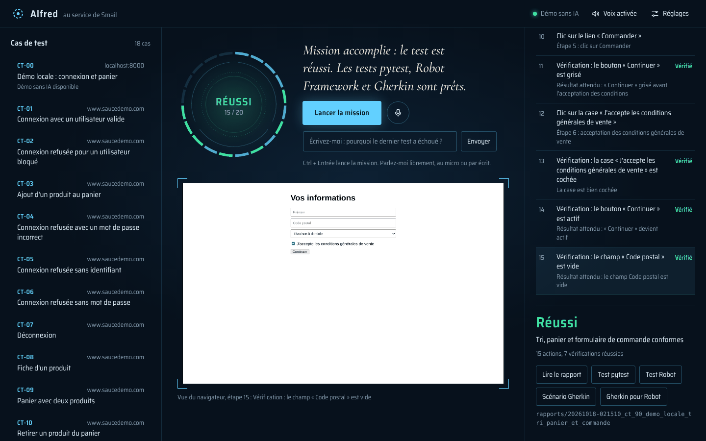
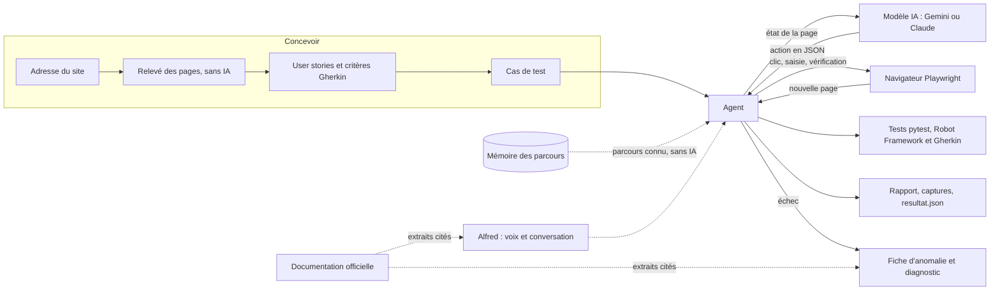
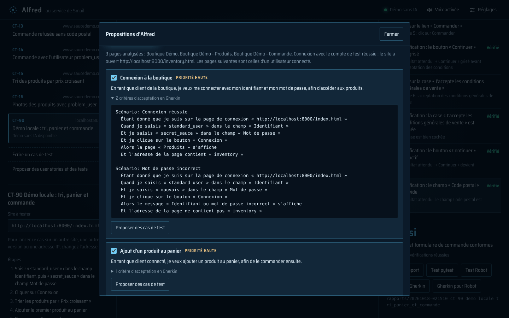

# Agent QA Playwright


Un agent IA qui conçoit, exécute et analyse des tests web, comme le ferait un testeur.

On lui donne l'adresse d'un site, ou un cas de test écrit en français comme dans Squash TM. Il pilote un vrai navigateur avec Playwright, vérifie chaque résultat attendu, puis produit des tests automatisés qui se rejouent ensuite **sans IA** : gratuits, rapides et toujours identiques.

| | Ce que fait l'agent |
|---|---|
| **Concevoir** | À partir d'une URL, il analyse le site et propose des **user stories** avec leurs critères d'acceptation en **Gherkin**, puis les **cas de test** d'une user story. |
| **Exécuter** | Il exécute un cas de test, en Markdown ou en Gherkin, avec six familles de vérifications (texte, URL, ordre, nombre, valeur d'un champ ou son format, état d'un bouton ou d'une case). Il entre dans les **iframes** et les **composants web (Shadow DOM)**, même fermés, manie les **listes déroulantes maison**, répond aux **fenêtres JavaScript**, accepte le **bandeau de cookies** et **attend** un chargement lent. Il tape des **touches du clavier**, **survole**, **double-clique**, fait un **clic droit**, **fait défiler** la page, suit un **nouvel onglet**, **joint un fichier** et **glisse-dépose**. Avec la **vision**, le modèle voit aussi l'écran. |
| **Industrialiser** | Chaque exécution génère un test **pytest-playwright**, un test **Robot Framework** (SeleniumLibrary) et un **scénario Gherkin** exécutable. Un parcours réussi est **mémorisé** et rejoué sans IA ; si le site change, l'IA répare le parcours (**auto-réparation**). |
| **Analyser** | Quand un test échoue, il rédige la **fiche d'anomalie** (étapes pour reproduire, résultat obtenu et attendu, capture), avec un diagnostic de l'IA présenté comme un avis à confirmer. Sur une erreur technique, le diagnostic s'appuie sur la **documentation officielle** de Playwright, liens à l'appui. |
| **Piloter** | **Alfred**, une interface vocale, commente la mission en direct et répond aux questions : « pourquoi le dernier test a échoué ? », « refais le test de connexion sur le site de recette », « comment gère-t-on une iframe avec Robot Framework ? » (réponse tirée de la documentation officielle, avec le lien). |
| **Se mesurer** | Une **campagne terrain** de 20 cas sur cinq sites d'entraînement, avec un verdict attendu pour chacun, et un **bilan** qui compte les verdicts justes, les faux PASS, les faux FAIL, les appels au modèle et la durée. |

L'IA propose, le programme vérifie : le verdict vient toujours des vérifications réelles, jamais de l'avis du modèle (voir [Les garde-fous](#les-garde-fous)).



## Comment ça marche



À l'ouverture de la page, un bandeau de cookies qui la couvre est accepté par le programme, sans IA (voir [Le bandeau de cookies](#le-bandeau-de-cookies)). Puis, à chaque tour de l'agent :

1. **Observer** : l'agent liste les éléments visibles de la page (champs, boutons, liens, listes, cases à cocher) et les numérote. Il regarde aussi dans les cadres (iframes) et les composants web (Shadow DOM), et repère les éléments cliquables sans rôle standard, comme les options d'une liste déroulante faite de div. Un champ sans attribut est nommé par le libellé posé à côté de lui.
2. **Décider** : il envoie au modèle le cas de test, l'historique et cette liste, données personnelles masquées. Le modèle répond par une seule action en JSON, par exemple `{"action": "fill", "args": {"ref": 1, "text": "standard_user"}}`.
3. **Agir** : l'agent valide la réponse, exécute l'action avec Playwright et prend une capture.
4. On recommence jusqu'à ce que le modèle termine le test.

## Les garde-fous

Une IA peut se tromper. Le programme ne lui fait pas confiance aveuglément :

- **Pas de sélecteur inventé** : le modèle désigne un élément par son numéro dans la liste, il ne peut pas cibler un élément qui n'existe pas.
- **Réponse validée** : une réponse mal formée ou une action inconnue n'est jamais exécutée. L'erreur est renvoyée au modèle pour qu'il corrige.
- **Statut fondé sur les vérifications** : si une vérification échoue, le test est FAIL, même si le modèle conclut PASS. Un PASS sans aucune vérification est refusé (statut BLOQUÉ).
- **Limites** : 20 actions du modèle au maximum et arrêt après 3 erreurs de suite.
- **Mémoire prudente** : seuls les parcours réussis sont mémorisés, et un élément n'est rejoué que s'il est retrouvé à l'identique. Au moindre doute, c'est le modèle qui cherche.
- **Diagnostic présenté comme un avis** : la fiche d'anomalie sépare les faits (étapes, résultats, capture) de l'avis de l'IA, à confirmer par un testeur.
- **Quotas respectés** : quand l'API signale une limite par minute, l'agent patiente le temps qu'elle indique, et Alfred l'annonce. Un quota du jour épuisé arrête la mission, avec l'heure de renouvellement.
- **Clés protégées** : les clés d'API restent dans un fichier `.env`, exclu de Git, comme le dossier `memoire/`.
- **Mots de passe jamais envoyés au modèle** : un mot de passe du cas de test est remplacé par le repère « [mot de passe] » dans tout ce qui part au modèle. Le modèle saisit ce repère, et le programme tape le vrai mot de passe à sa place. Le rapport, la fiche d'anomalie et la mémoire ne gardent que le repère. Les tests générés lisent le mot de passe dans le fichier `.env`, où l'agent le range (`MOT_DE_PASSE_SAUCEDEMO_COM`) : il n'est écrit dans aucun fichier produit.
- **Fichiers joints contrôlés** : l'agent ne joint qu'un fichier du dossier `donnees_de_test/`, désigné par son nom, sans chemin. Une réponse du modèle qui donnerait un chemin (`../.env`) est refusée.
- **Données personnelles masquées** : avant chaque envoi au modèle, les adresses e-mail, numéros de téléphone, de carte bancaire et IBAN affichés par la page sont remplacés par un repère (« [e-mail masqué] »), sauf ceux que le cas de test donne lui-même. Les noms et les adresses postales aussi : la valeur d'un champ Nom, Prénom, Adresse, Code postal ou Ville, une adresse comme « 12 rue de la Paix, 75002 Paris », et le nom qui suit « Bonjour » ou « Logged in as ». Un numéro de carte n'est masqué que s'il passe le contrôle de Luhn, un IBAN que si sa clé est juste : un numéro de commande reste lisible.
- **Bandeau de cookies accepté sans IA** : seul le bouton qui accepte un bandeau de cookies est cliqué par le programme. Un bouton « Accepter » hors d'un tel bandeau ne l'est jamais, et un cas de test qui porte sur le bandeau (le refuser, vérifier qu'il s'affiche) le laisse au modèle.
- **Fenêtres JavaScript tracées** : une fenêtre d'alerte ou de confirmation reçoit OK, sauf consigne contraire du modèle (action `dialog`), et son message est noté dans le rapport. Les tests générés lui font la même réponse, après avoir vérifié son message.
- **Vision signalée** : une vérification faite à l'œil par l'IA sur une capture (`check_visual`) est marquée comme un avis dans le rapport, n'est pas rejouée par les tests générés (elle y figure comme « à automatiser ») et un parcours qui en dépend n'est pas mémorisé.
- **Conversation contrôlée** : quand on parle librement à Alfred, le modèle ne peut que proposer une action d'une liste fermée (lancer, afficher, arrêter, ouvrir un fichier, rédiger un cas, analyser un site). Le programme vérifie que le cas existe et que l'adresse est valide, et la réponse lue à voix haute ne contient jamais un mot de passe.
- **Sources contrôlées** : pour une question sur Playwright, Selenium ou Robot Framework, ou pour une erreur technique, le programme lit lui-même des pages officielles, choisies dans une liste fermée, et n'envoie au modèle que des extraits numérotés. Les liens affichés sont ceux des extraits que le modèle a cités : il ne peut ni inventer une source, ni citer une page qu'il n'a pas reçue, et une adresse écrite dans sa réponse est retirée.
- **Propositions relues** : les user stories et les cas proposés par l'IA sont contrôlés (format, mots-clés Gherkin, étapes, résultats attendus), rien n'est enregistré sans l'accord du testeur, et le mot de passe du compte de test n'est jamais envoyé au modèle.

## Installation (Mac ou Linux)

Il faut Python 3.10 ou plus récent.

```bash
git clone https://github.com/smail-ops/agent-qa-playwright.git
cd agent-qa-playwright
python3 -m venv .venv
source .venv/bin/activate
pip install -r requirements.txt
playwright install chromium
cp .env.example .env
```

Ouvre ensuite le fichier `.env` et colle ta clé Gemini après `GEMINI_API_KEY=`. Elle se crée gratuitement sur [Google AI Studio](https://aistudio.google.com).

## Premier essai, sans clé d'API

Le dossier `demo_site/` contient une petite boutique de démonstration. Le fournisseur `scripted` rejoue un scénario écrit à l'avance, sans IA. Pratique pour vérifier l'installation.

Dans un premier terminal :

```bash
python3 -m http.server 8000 -d demo_site
```

Dans un second terminal (environnement `.venv` activé) :

```bash
python -m agent cas_de_test/demo/CT-00_demo_locale.md --provider scripted --scenario cas_de_test/demo/scenario_CT-00.json --headed
```

Une seconde démo, `CT-90`, montre les vérifications plus riches (tri, nombre de boutons, bouton grisé, case cochée) :

```bash
python -m agent cas_de_test/demo/CT-90_demo_tri_et_commande.md --provider scripted --scenario cas_de_test/demo/scenario_CT-90.json --headed
```

Une troisième démo, `CT-91`, réunit ce qui bloquait l'agent sur les vrais sites : un éditeur de texte dans une iframe, un composant web (Shadow DOM), des listes déroulantes faites de div, une fenêtre de confirmation et un chargement de 3 secondes :

```bash
python -m agent cas_de_test/demo/CT-91_demo_iframe_shadow_dom.md --provider scripted --scenario cas_de_test/demo/scenario_CT-91.json --headed
```

Une quatrième démo, `CT-92`, s'ouvre sous un bandeau de cookies qui couvre la page, comme automationexercise.com vu depuis l'Europe. Le programme l'accepte, sans IA, avant que l'agent ne remplisse le formulaire d'inscription :

```bash
python -m agent cas_de_test/demo/CT-92_demo_inscription_lettre.md --provider scripted --scenario cas_de_test/demo/scenario_CT-92.json --headed
```

Deux démos réunissent les actions au clavier et à la souris. `CT-93` : une recherche lancée avec Entrée, un menu qui s'ouvre au survol, un double-clic, un clic droit fermé avec Échap, et des avis qui se chargent en bas de page. `CT-94` : un lien qui ouvre un nouvel onglet, un fichier à joindre, une tâche à glisser-déposer et un composant web fermé :

```bash
python -m agent cas_de_test/demo/CT-93_demo_clavier_souris.md --provider scripted --scenario cas_de_test/demo/scenario_CT-93.json --headed
```

```bash
python -m agent cas_de_test/demo/CT-94_demo_onglets_fichiers.md --provider scripted --scenario cas_de_test/demo/scenario_CT-94.json --headed
```

Exemples de résultats : [`docs/exemple-demo`](docs/exemple-demo/rapport.md), [`docs/exemple-tri-commande`](docs/exemple-tri-commande/rapport.md) et [`docs/exemple-atelier`](docs/exemple-atelier/rapport.md).

Encore plus simple : `python -m alfred` ouvre l'interface Alfred, qui sert elle-même le site de démo (un seul terminal suffit). Sur Mac, un double-clic sur `Alfred.command` fait la même chose.

## Lancer un vrai test avec l'IA

Les cas de test du dossier `cas_de_test/` portent sur [SauceDemo](https://www.saucedemo.com), un site public conçu pour s'entraîner au test.

```bash
python -m agent cas_de_test/CT-01_connexion_valide.md --headed --pause 4
```

- `--headed` affiche le navigateur pendant le test.
- `--pause 4` attend 4 secondes entre deux actions, pour rester dans les quotas de l'offre gratuite de Gemini.
- `--provider claude` utilise Claude à la place de Gemini (clé `ANTHROPIC_API_KEY` dans `.env`).
- `--model` choisit un modèle précis, par exemple `--model gemini-3.8-flash`. Par défaut, l'agent utilise l'alias `gemini-flash-latest`, qui suit le dernier modèle Flash de Google.
- `--url` lance le cas sur une autre adresse (recette, préproduction, adresse IP) sans modifier son fichier, par exemple `--url http://192.168.1.20:8080/`.
- `--sans-memoire` ignore le parcours mémorisé : tout le test passe par le modèle.
- `--vision` envoie aussi la capture d'écran de la page au modèle (voir [La vision](#la-vision)).

Un fichier Gherkin se lance de la même façon : chaque scénario du `.feature` est exécuté comme un cas de test, l'un après l'autre (`--numero 2` pour n'en lancer qu'un).

```bash
python -m agent cas_de_test/US-01_connexion.feature
```

Le programme renvoie un code de sortie exploitable en intégration continue : 0 pour PASS, 1 pour FAIL, 2 pour BLOQUÉ, 3 pour une erreur de configuration.

## Alfred, l'interface vocale

Alfred est une interface web locale. On choisit un cas de test (ou on l'écrit), Alfred lance l'agent et annonce chaque action à voix haute, pendant que le cadran montre où en est la mission et que la vue du navigateur s'affiche en direct. À la fin : le verdict, le rapport, les tests générés et, en cas d'échec, la fiche d'anomalie.

```bash
python -m alfred
```

Sur Mac, tu peux aussi double-cliquer sur `Alfred.command`, à la racine du projet. La page s'ouvre toute seule sur http://127.0.0.1:8765. Alfred sert aussi le site de démo : les cas de démo (CT-00 et CT-90 à CT-94) fonctionnent avec le moteur « Démo sans IA », sans clé d'API.

- **Le cadran** : l'anneau extérieur compte les actions (20 au plus), en vert les vérifications réussies et en rouge les échecs. L'anneau intérieur montre la phase en cours : observer, réfléchir, agir.
- **La voix** : Alfred annonce ce qu'il fait, puis le verdict. Les mots de passe ne sont jamais lus ni affichés.
- **Parler à Alfred** : au micro ou dans le champ « Écrivez-moi ». Voir [Parler librement à Alfred](#parler-librement-à-alfred).
- **Le site à tester** : le champ sous le titre du cas remplace son adresse le temps d'une mission (autre site, recette, adresse IP). Le fichier du cas ne change pas.
- **La mémoire** : un cas déjà réussi affiche « Parcours en mémoire ». La mission suivante le rejoue sans IA (les étapes rejouées portent la mention « Mémoire »), et Alfred annonce s'il doit réparer le parcours. La case « Ignorer la mémoire » refait tout avec l'IA.
- **L'analyse des échecs** : quand un test échoue, Alfred annonce le diagnostic de l'IA (bug de l'application, problème du test ou de l'environnement) et le bouton « Fiche d'anomalie » ouvre la fiche prête à copier.
- **Écrire un cas de test** directement dans la page, le lancer, puis l'enregistrer dans `cas_de_test/`.
- **Proposer des user stories et des tests** : Alfred analyse un site et propose des user stories (critères en Gherkin), ou rédige les cas de test d'une user story, tapée ou dictée. Voir [Proposer des user stories et des cas de test](#proposer-des-user-stories-et-des-cas-de-test).
- **La vision** : la case « Vision » envoie aussi la capture de la page au modèle.
- **La reconnaissance du maître** : au démarrage, Alfred se présente et salue son maître à voix haute, avec la voix du Mac. Au premier lancement sur un ordinateur, il demande ton prénom et l'enregistre dans le `.env` de cet ordinateur (`ALFRED_MAITRE`) : chaque installation connaît son maître. `--silencieux` coupe la salutation, `ALFRED_VOIX` choisit la voix.
- **Réglages** : changer le prénom, et la voix utilisée dans la page.

### Parler librement à Alfred

Alfred comprend deux sortes de phrases :

- **Les commandes simples**, comprises dans la page, sans IA et sans quota : « lance la démo », « lance le cas 2 », « vas-y », « arrête », « ouvre le rapport », « ouvre la fiche d'anomalie ». « Qui es-tu ? » et « présente-toi » aussi : Alfred se présente, même sans clé d'API.
- **Les questions sur un outil de test** : « comment gère-t-on une iframe avec Robot Framework ? ». Alfred répond à partir de la documentation officielle, et le lien s'affiche sous sa réponse. Voir [Questions sur Playwright, Selenium et Robot Framework](#questions-sur-playwright-selenium-et-robot-framework).
- **Tout le reste** : une question ou une demande libre part au modèle (Gemini ou Claude), avec le contexte utile : la liste des cas de test, le cas affiché, la mission en cours et les derniers résultats (statut, vérifications en échec, diagnostic de l'IA). Une requête par phrase.

Quelques exemples :

| Ce que tu dis | Ce que fait Alfred |
|---|---|
| « Pourquoi le dernier test a échoué ? » | il répond à partir du résultat et du diagnostic, et propose d'ouvrir la fiche d'anomalie |
| « Comment fonctionnes-tu ? », « Quelles sont tes limites ? » | il répond à partir de sa fiche : version, auteur, fonctionnement de l'agent, tests générés et limites |
| « Quels tests ont échoué aujourd'hui ? » | il les cite, à partir des résultats du jour |
| « Refais le test de connexion sur le site de recette » | il choisit le bon cas, change l'adresse et lance la mission |
| « Vérifie qu'on ne peut pas commander sans code postal » | il rédige le cas au format CT, l'affiche, et le lance quand tu dis « vas-y » |
| « Analyse saucedemo.com et propose des user stories » | il ouvre les propositions et lance l'analyse |
| « Montre-moi la fiche d'anomalie de CT-14 » | il l'ouvre, même si le test a tourné un autre jour |
| « Comment on gère une iframe avec Robot Framework ? » | il lit la documentation de SeleniumLibrary et répond à partir des extraits (Select Frame, puis Unselect Frame), avec le lien sous la réponse |

Alfred garde les derniers échanges en tête : on peut enchaîner (« et celui d'avant ? »). Sans clé d'API, seules les commandes simples fonctionnent, et Alfred le dit ; à une question sur un outil, il donne quand même les liens de la documentation officielle. Les résultats viennent du fichier `resultat.json` que chaque exécution écrit dans son dossier de rapport.

### Questions sur Playwright, Selenium et Robot Framework

Une question qui cite un outil (« comment… », « quel mot-clé… », « pourquoi j'ai une StaleElementReferenceException… ») ne part pas au modèle telle quelle :

1. Le programme choisit au plus deux pages dans une liste fermée de pages officielles (playwright.dev, selenium.dev, robotframework.org), d'après les mots de la question. Les mots français trouvent leur équivalent anglais : « cadre » cherche aussi frame, « survoler » cherche hover. Si aucun mot ne désigne une page, il lit les références de l'outil, par exemple les mots-clés de SeleniumLibrary et de BuiltIn.
2. Il lit ces pages et les découpe par titres. La documentation des mots-clés de Robot Framework est construite en JavaScript : le programme lit directement ses données, un mot-clé par partie.
3. Il garde les quatre parties les plus proches de la question, avec le classement des moteurs de recherche (BM25) : un mot rare compte plus qu'un mot présent partout, et « Input Text » passe avant « Input Text Into Alert ».
4. Le modèle reçoit ces extraits numérotés, répond à partir d'eux seulement et donne les numéros qui appuient sa réponse. Les liens affichés sous la réponse sont ceux de ces extraits, avec l'ancre de la partie (`SeleniumLibrary.html#Select%20Frame`).

Une question coûte une requête au modèle, comme une autre phrase : aucune recherche web payante. Les pages lues restent en mémoire jusqu'à l'arrêt d'Alfred. Sans réseau, ou si le quota du modèle est épuisé, Alfred donne les liens des pages qui en parlent. Si les pages lues ne parlent pas du sujet, il répond comme d'habitude.

Sous le capot, le serveur n'utilise que la bibliothèque standard de Python et la page n'a pas de framework. Chaque événement de l'agent (observer, réfléchir, agir, étape terminée, mémoire, réparation, analyse) est diffusé à la page en Server-Sent Events. Le serveur n'écoute que sur 127.0.0.1, refuse les requêtes venant d'autres sites et ne sert que les fichiers de ses propres missions.

## Écrire un cas de test

Un fichier Markdown, avec un titre et une URL. Le reste est lu par l'IA comme par un testeur :

```markdown
# CT-02 Connexion refusée pour un utilisateur bloqué
URL : https://www.saucedemo.com/

## Étapes
1. Saisir « locked_out_user » dans le champ Username
2. Saisir « secret_sauce » dans le champ Password
3. Cliquer sur le bouton Login

## Résultats attendus
- Le message « Sorry, this user has been locked out. » s'affiche
- L'URL ne contient pas « inventory »
```

Un mot de passe s'écrit entre guillemets, sur la ligne qui parle du mot de passe (« Saisir « secret_sauce » dans le champ Password »). Le programme le reconnaît ainsi : il ne l'envoie jamais au modèle et ne l'écrit dans aucun fichier produit (voir [Les garde-fous](#les-garde-fous)).

Pour chaque résultat attendu, l'agent choisit la vérification la plus précise :

| Résultat attendu | Vérification | Dans le test pytest | Dans le test Robot |
|---|---|---|---|
| un texte s'affiche, ou ne s'affiche pas | `check_text` | `to_contain_text` | `La page affiche` |
| l'URL contient, ou ne contient pas | `check_url` | `to_have_url` | `Wait Until Location Contains` |
| un ordre (« triés par prix croissant ») | `check_order` | expression régulière « A.*B » | `La page affiche dans l'ordre` |
| un nombre (« 2 boutons Remove ») | `check_count` | `compte()` | `La page affiche ce nombre de fois` |
| le contenu d'un champ, l'option d'une liste | `check_value` | `to_have_value` | `Textfield Value Should Be`, `List Selection Should Be` |
| un bouton grisé ou actif, une case cochée | `check_state` | `to_be_disabled`, `to_be_checked` | `Element Should Be Disabled`, `Checkbox Should Be Selected` |

Les résultats attendus négatifs (« ne s'affiche pas », « ne contient pas ») sont contrôlés avec l'option « absent ». Comme Playwright, chaque vérification laisse quelques secondes à la page pour atteindre l'état attendu, et seul le texte visible compte : un message d'erreur caché dans la page n'est pas considéré comme affiché.

Un cas de test peut aussi s'écrire en **Gherkin**, dans un fichier `.feature` : une ligne `# URL : https://...`, une `Fonctionnalité:` et ses `Scénario:`. Chaque scénario apparaît dans Alfred et se lance comme un cas : les lignes « Étant donné que » et « Quand » sont les étapes, les lignes « Alors » les résultats attendus.

```gherkin
# language: fr
# URL : https://www.saucedemo.com/
@US-01
Fonctionnalité: US-01 Connexion à la boutique
  En tant que client
  Je veux me connecter avec mon identifiant et mon mot de passe
  Afin d'accéder aux produits

  Scénario: Connexion réussie
    Étant donné que je suis sur la page de connexion
    Quand je saisis « standard_user » dans le champ « Username »
    Et je saisis « secret_sauce » dans le champ « Password »
    Et je clique sur le bouton « Login »
    Alors la page « Products » s'affiche
```

## Proposer des user stories et des cas de test

L'agent peut aussi préparer les tests. Dans Alfred, le bouton « Proposer des user stories et des tests » ouvre deux parcours :

1. **À partir d'un site** : Alfred ouvre l'adresse, parcourt quelques pages du même site (5 au plus) et relève les titres, les champs, les listes, les boutons, les liens et le texte visible. Ce relevé est fait par le programme, sans IA. Le modèle le reçoit ensuite, avec les captures si la vision est cochée, et propose de 3 à 6 **user stories** (« En tant que..., je veux..., afin de... »), classées par priorité, chacune avec ses **critères d'acceptation en Gherkin**. Une seule requête au modèle.
2. **À partir d'une user story** (proposée par Alfred, tapée ou dictée) : le modèle rédige de 2 à 5 **cas de test** au format des fichiers CT, le cas nominal d'abord, puis les cas d'erreur et les limites. Une requête de plus.

On coche les propositions à garder. Une user story devient un fichier `cas_de_test/US-xx_....feature`, dont chaque scénario se lance comme un cas de test. Un cas devient `cas_de_test/CT-xx_....md`, avec le prochain numéro libre.



Pendant l'analyse, rien n'est modifié sur le site : seuls les liens du même site sont suivis, jamais ceux qui pourraient déconnecter, supprimer ou payer, et aucun bouton n'est cliqué. Pour voir les pages réservées aux utilisateurs, on peut donner un **compte de test** : Alfred remplit le formulaire de connexion de la première page. Le mot de passe sert uniquement à cette connexion : il n'est ni envoyé au modèle, ni affiché, ni enregistré. Comme le modèle ne le connaît pas, il écrit `<mot de passe>` dans ses propositions (à compléter dans le fichier), sauf si le site l'affiche en clair, comme SauceDemo.

Le moteur « Démo sans IA » rejoue des réponses enregistrées pour le site de démo local : de quoi essayer sans clé d'API.

En ligne de commande, les propositions sont écrites dans un dossier `propositions/` (exclu de Git), à relire avant de les déplacer dans `cas_de_test/` :

```bash
python -m agent.propositions https://www.saucedemo.com/ --identifiant standard_user
python -m agent.propositions https://www.saucedemo.com/ --user-story "En tant que client, je veux trier les produits par prix, afin de trouver le moins cher."
```

Avec `--identifiant`, le mot de passe est demandé sans s'afficher à l'écran (il n'apparaît pas non plus dans l'historique du terminal).

## La vision

Avec `--vision` (ou `AGENT_VISION=1` dans `.env`, ou la case « Vision » d'Alfred), le modèle reçoit à chaque tour une capture d'écran de la page, en plus de la liste des éléments. Il comprend mieux la mise en page, et une action de plus lui est ouverte : `check_visual`, pour un résultat attendu qui ne se vérifie qu'à l'œil (une photo, une couleur, une mise en page).

Une telle vérification reste l'avis du modèle sur une capture, pas une mesure : le rapport l'indique, les tests générés la gardent en commentaire « à automatiser », et un parcours qui en dépend n'est pas mémorisé. Le cas **CT-16** en montre l'intérêt : avec l'utilisateur `problem_user`, SauceDemo affiche la même photo pour tous les produits, un défaut invisible dans le texte de la page.

La vision coûte un peu plus cher : chaque requête envoie une image (en JPEG, de faible poids).

## La campagne SauceDemo

Le dossier `cas_de_test/` contient une campagne de 16 cas sur [SauceDemo](https://www.saucedemo.com), des cas positifs et des cas négatifs :

| Domaine | Cas | Verdict attendu |
|---|---|---|
| Connexion | CT-01 Connexion avec un utilisateur valide | PASS |
| Connexion | CT-02 Connexion refusée pour un utilisateur bloqué | PASS |
| Connexion | CT-04 Connexion refusée avec un mot de passe incorrect | PASS |
| Connexion | CT-05 Connexion refusée sans identifiant | PASS |
| Connexion | CT-06 Connexion refusée sans mot de passe | PASS |
| Connexion | CT-07 Déconnexion | PASS |
| Catalogue | CT-08 Fiche d'un produit | PASS |
| Catalogue | CT-15 Tri des produits par prix croissant | PASS |
| Panier | CT-03 Ajout d'un produit au panier | PASS |
| Panier | CT-09 Panier avec deux produits | PASS |
| Panier | CT-10 Retirer un produit du panier | PASS |
| Commande | CT-11 Commande complète | PASS |
| Commande | CT-12 Récapitulatif de commande avec les taxes | PASS |
| Commande | CT-13 Commande refusée sans code postal | PASS |
| Commande | CT-14 Commande avec l'utilisateur problem_user | FAIL : bug connu de SauceDemo, le nom de famille saisi n'est pas gardé |
| Catalogue | CT-16 Photos des produits avec problem_user (avec la vision) | FAIL : bug connu de SauceDemo, la même photo pour tous les produits |

CT-14 et CT-16 montrent que l'agent détecte de vrais défauts : l'utilisateur de test `problem_user` de SauceDemo contient des bugs volontaires, et l'agent rédige la fiche d'anomalie. Chaque cas consomme une dizaine d'appels au modèle la première fois. Grâce à la mémoire, les exécutions suivantes d'un cas réussi n'en consomment plus aucun : avec l'offre gratuite de Gemini, lance les nouveaux cas quelques-uns à la fois.

## La campagne terrain

SauceDemo ne suffit pas pour juger l'agent : il faut le mesurer sur des sites qu'il ne connaît pas. Le dossier `cas_de_test/terrain/` contient une campagne de 20 cas sur cinq sites publics d'entraînement au test, quatre par site : deux parcours normaux, un cas négatif et un piège.

| Site | Parcours normaux | Cas négatif | Piège |
|---|---|---|---|
| [Automation Exercise](https://automationexercise.com) | CT-17 recherche d'un produit, CT-18 quantité reprise dans le panier | CT-19 connexion refusée | CT-20 formulaire de contact, confirmé par une fenêtre JavaScript |
| [ParaBank](https://parabank.parasoft.com/parabank/index.htm) | CT-21 connexion, CT-22 ouverture d'un compte épargne | CT-23 connexion refusée | CT-24 virement d'un montant négatif |
| [OrangeHRM](https://opensource-demo.orangehrmlive.com) | CT-25 connexion, CT-26 ajout d'un employé | CT-27 connexion refusée | CT-28 filtre par une liste déroulante maison |
| [The Internet](https://the-internet.herokuapp.com) | CT-29 connexion, CT-30 images de la galerie (avec la vision) | CT-31 connexion refusée | CT-32 éditeur de texte dans une iframe |
| [UI Testing Playground](http://uitestingplayground.com) | CT-33 connexion, CT-34 données arrivées après 15 secondes | CT-35 connexion refusée | CT-36 composant Shadow DOM |

Les pièges visaient les limites de l'agent en version 0.4 : fenêtres JavaScript, listes déroulantes maison, iframes et Shadow DOM. La version 0.5 les lève, et ajoute l'attente d'un chargement lent : les verdicts attendus de ces pièges sont passés de BLOQUÉ à PASS. Deux cas portent sur de vrais défauts des sites : les images cassées de The Internet et le virement négatif accepté par ParaBank. Les 20 cas apparaissent aussi dans Alfred.

Le verdict attendu de chaque cas (PASS, FAIL ou BLOQUÉ) et sa raison sont dans un fichier à part, [`cas_de_test/terrain/campagne.md`](cas_de_test/terrain/campagne.md), jamais dans le cas lui-même : le modèle lit tout le texte d'un cas, il ne doit pas connaître la réponse. BLOQUÉ est attendu quand une limite connue empêche l'agent de faire une étape : le bon réflexe est alors de le dire, plutôt que d'accuser le site ou d'annoncer un succès.

La campagne se lance un site par jour, un cas après l'autre, sans la mémoire des parcours (`--sans-memoire`) pour que chaque cas mesure vraiment le modèle. Les commandes de chaque journée sont dans le fichier de campagne, par exemple :

```bash
python -m agent cas_de_test/terrain/parabank/CT-21_connexion_compte_demo.md --headed --pause 4 --sans-memoire
```

### Le bilan de la campagne

```bash
python -m agent.bilan
```

Le bilan relit les `resultat.json` du dossier `rapports/`, retient la dernière exécution de chaque cas et la compare au verdict attendu :

| Résultat | Signification |
|---|---|
| ✅ juste | le verdict de l'agent est le verdict attendu |
| ❌ faux PASS | l'agent conclut PASS alors qu'on attendait FAIL ou BLOQUÉ : un défaut manqué, ou un succès annoncé sans pouvoir le constater. C'est l'erreur la plus grave, car personne ne relit un test au vert |
| ❌ faux FAIL | l'agent conclut FAIL alors qu'on attendait PASS ou BLOQUÉ : il accuse le site à tort |
| ⚠️ BLOQUÉ à tort | l'agent ne conclut pas alors qu'on attendait PASS ou FAIL |
| ⏸️ à relancer | l'exécution a été coupée (quota du jour, réseau, arrêt demandé) : ce n'est pas un verdict de l'agent |

Il compte aussi les appels au modèle (diagnostic de la fiche d'anomalie compris) et la durée des exécutions, au total, par cas et par site. Le terminal affiche une ligne par cas. Le bilan complet est écrit dans `rapports/bilan_campagne.md` : les indicateurs, le tableau des verdicts attendus et obtenus, le détail par site et par cas (avec le lien vers chaque rapport), puis chaque écart à analyser, avec la raison attendue, la conclusion de l'agent, ses vérifications en échec et l'avis de l'IA. Les FAIL et les BLOQUÉ justes sont repris à part : le verdict est le bon, reste à vérifier qu'il l'est pour la bonne raison.

- `--site parabank` ne garde qu'un site : le bilan du jour.
- `--depuis 2026-10-23` et `--jusqua 2026-10-22` ne gardent que les exécutions d'une période : de quoi comparer la campagne avant et après une amélioration.
- `--sortie docs/bilan_terrain.md` écrit le bilan ailleurs, par exemple pour le publier (le dossier `rapports/` est exclu de Git).
- `--campagne` et `--rapports` changent le fichier de campagne et le dossier des rapports.

L'oracle de la version 0.4 est gardé dans [`campagne_v0.4.md`](cas_de_test/terrain/campagne_v0.4.md) : le bilan « avant » relit les exécutions jusqu'au 22 octobre avec lui, le bilan « après » relit les suivantes avec l'oracle à jour (commandes dans le fichier de campagne).

## Résultats

Chaque exécution crée un dossier `rapports/<date>_<cas_de_test>/` contenant :

| Fichier | Contenu |
|---|---|
| `rapport.md` | statut, appels au modèle, usage de la mémoire, tableau des étapes avec la raison de chaque action, vérifications |
| `captures/` | une capture d'écran par étape |
| `test_<cas_de_test>.py` | le script pytest qui rejoue le test sans IA |
| `<cas_de_test>.robot` | le test Robot Framework qui rejoue le test avec Selenium |
| `<cas_de_test>.feature` | le scénario Gherkin en français |
| `<cas_de_test>_bdd.robot` | le même scénario Gherkin, exécutable avec Robot Framework |
| `anomalie.md` | la fiche d'anomalie, seulement si le test échoue ou reste bloqué |
| `resultat.json` | le même bilan, lisible par un programme : statut, vérifications en échec, diagnostic, fichiers produits |

Pour rejouer le script pytest :

```bash
pytest rapports/<dossier>/test_<cas_de_test>.py
```

### Rejouer avec Robot Framework

Le fichier `.robot` utilise SeleniumLibrary, la bibliothèque de Robot Framework qui pilote le navigateur avec Selenium. Il faut Google Chrome sur la machine : Selenium télécharge seul le pilote qui correspond à sa version.

```bash
robot rapports/<dossier>/<cas_de_test>.robot
```

- `--variable BROWSER:headlesschrome` lance Chrome sans fenêtre, par exemple en intégration continue (`firefox` fonctionne aussi).
- `--variable DELAI:10s` allonge l'attente maximale, 5 secondes par défaut.
- `--outputdir resultats-robot` range le journal (`log.html` et `report.html`) dans un dossier à part.

Le générateur adapte le parcours à Selenium :

- les sélecteurs propres à Playwright (`:has-text`, plusieurs éléments identiques) deviennent des XPath ;
- le texte attendu est écrit tel qu'il apparaît sur la page, et pour une liste déroulante c'est la valeur réelle de l'option qui est utilisée ;
- les vérifications de texte passent par des mots-clés écrits dans le fichier (`La page affiche`, `La page n'affiche pas`, `La page affiche dans l'ordre`, `La page affiche ce nombre de fois`). Comme l'agent, ils ne regardent que le texte visible. `Wait Until Page Contains` compterait aussi un message d'erreur caché dans la page, et le test passerait à tort ;
- le navigateur s'ouvre avec le mot-clé `Ouvrir le navigateur`, lui aussi écrit dans le fichier. Avec Chrome, il coupe le gestionnaire de mots de passe (variable `${OPTIONS_CHROME}`) : sinon, après une connexion avec un mot de passe connu des fuites de données, comme `secret_sauce`, Chrome affiche une alerte « mot de passe compromis » qui interrompt le test.

Exemple : [`docs/exemple-demo/ct_00_demo_locale_connexion_et_panier.robot`](docs/exemple-demo/ct_00_demo_locale_connexion_et_panier.robot).

### Le scénario Gherkin

Le fichier `.feature` décrit le parcours en langage métier, dans le format des scénarios BDD (Cucumber, Squash TM, Behave) :

```gherkin
# language: fr
Fonctionnalité: CT-90 Démo locale : tri, panier et commande

  @CT-90
  Scénario: CT-90 Démo locale : tri, panier et commande
    Étant donné que je suis sur la page "http://localhost:8000/index.html"
    Quand je saisis "standard_user" dans le champ "Identifiant"
    Et je saisis "secret_sauce" dans le champ "Mot de passe"
    Et je clique sur le bouton "Connexion"
    Alors la page affiche 3 fois "Ajouter au panier"
    Quand je choisis "Prix croissant" dans la liste "Trier"
    Alors la page affiche dans cet ordre : "Lampe de vélo", "T-shirt" et "Sac à dos"
    Quand je clique sur le bouton "Ajouter au panier" n°1
    Alors la page affiche 1 fois "Retirer"
    Quand je clique sur le lien "Commander"
    Alors le bouton "Continuer" est grisé
    Quand je clique sur la case "J'accepte les conditions générales de vente"
    Alors la case "J'accepte les conditions générales de vente" est cochée
    Et le bouton "Continuer" est actif
    Et le champ "Code postal" est vide
```

Robot Framework comprend ces mots-clés en français : le fichier `_bdd.robot` reprend le même scénario, et chaque phrase y devient un mot-clé qui rejoue l'étape avec SeleniumLibrary. Le scénario Gherkin est donc exécutable :

```bash
robot rapports/<dossier>/<cas_de_test>_bdd.robot
```

Exemple complet : [`docs/exemple-tri-commande`](docs/exemple-tri-commande/ct_90_demo_locale_tri_panier_et_commande.feature).

## Le bandeau de cookies

Sur un site européen, un bandeau de consentement (RGPD) couvre souvent la page à la première visite et bloque les clics tant qu'on n'y a pas répondu. Le testeur l'accepte et passe à la suite : l'agent fait de même, sans appel au modèle.

- **Avant que l'agent ne regarde la page**, le programme cherche le bouton qui accepte. Il reconnaît les outils de consentement courants (Google, OneTrust, Didomi, Axeptio, Cookiebot, Quantcast, tarteaucitron, Usercentrics...) et, à défaut, un bandeau fait par le site : un bloc fixe ou une fenêtre qui parle de cookies, avec un bouton « Tout accepter », « J'accepte », « Accept all »... Un bouton « Accepter » ailleurs dans la page n'est jamais cliqué.
- **Le bandeau arrive souvent après la page** : quand la page charge un outil de consentement, le programme l'attend 5 secondes au plus. Sans outil de consentement, il ne fait que regarder, sans rien attendre. Il regarde de nouveau avant chaque action, pour un bandeau qui arriverait plus tard.
- **Dans le rapport**, l'acceptation est une étape « cookies », marquée « Sans IA ». Elle ne compte pas dans les 20 actions du modèle, et la mémoire ne la garde pas : le programme la refait à chaque exécution.
- **Les tests générés** acceptent le bandeau s'il s'affiche : `page.add_locator_handler` dans le test pytest (Playwright clique dès que le bandeau couvre la page), le mot-clé « Accepter le bandeau de cookies » dans les tests Robot Framework, et la phrase « Et j'accepte le bandeau de cookies » dans le scénario Gherkin.
- **Un cas de test qui porte sur le bandeau** garde la main : son titre ou ses résultats attendus parlent du bandeau ou du consentement, ou il demande de refuser ou de personnaliser les cookies. Le bandeau est alors un élément comme un autre, que le modèle manie selon les étapes. Une étape qui demande seulement de l'accepter, comme dans les cas d'Automation Exercise, est faite par le programme.

## La mémoire des parcours

Quand un test réussit avec l'IA, son parcours est enregistré dans `memoire/` : les actions, et pour chaque élément son sélecteur et son XPath. À la prochaine exécution du même cas :

1. **Rejeu sans IA** : l'agent rejoue le parcours étape par étape. Aucun appel au modèle, le quota reste intact, et le test dure quelques secondes.
2. **Auto-réparation** : si un élément n'est plus retrouvé à l'identique (le site a changé) ou qu'une action n'aboutit plus, le modèle reprend la main à cette étape, avec l'historique de ce qui a déjà été fait. Si le test réussit, la mémoire est mise à jour avec le parcours réparé.
3. **Échec réel** : si une vérification échoue pendant le rejeu, c'est le comportement du site qui a changé : le test est FAIL, et la mémoire n'est pas modifiée.

Le parcours est lié au texte exact du cas de test et à son adresse : modifier le cas, ou le lancer sur un autre site, repart de l'IA. Pour tout refaire avec l'IA : `--sans-memoire`, la case « Ignorer la mémoire » dans Alfred, ou supprimer le dossier `memoire/`. La démo sans IA n'utilise pas la mémoire : elle rejoue déjà un scénario enregistré.

## La fiche d'anomalie

Quand un test échoue (ou reste bloqué), l'agent rédige `anomalie.md`, prête à reporter dans Jira, Mantis ou Squash TM :

- un titre, la gravité et la nature proposées ;
- l'environnement : site testé, version de Chromium, système ;
- les **étapes pour reproduire**, tirées des actions réellement réalisées (les tentatives ratées puis corrigées par l'agent n'y figurent pas) ;
- le **résultat obtenu** et le **résultat attendu**, repris du cas de test ;
- la capture au moment de l'échec, et les tests générés qui reproduisent l'échec.

Avec Gemini ou Claude, le modèle reçoit ensuite les faits (cas de test, historique, état final de la page) et propose un **diagnostic** : bug de l'application, problème du test ou problème d'environnement, avec une gravité, une explication et la prochaine action conseillée. Ce diagnostic coûte un appel au modèle, et il est présenté comme un avis à confirmer.

Quand l'échec vient d'une erreur technique de Playwright (« Timeout 5000ms exceeded », « strict mode violation », « Input of type "submit" cannot be filled »), le programme lit aussi les pages de la documentation officielle qui en parlent et joint au diagnostic les extraits les plus proches du message. Le modèle s'appuie dessus et cite ceux qui lui ont servi : la fiche et le rapport donnent leurs liens, sous « Dans la documentation officielle ». Une vérification en échec n'est pas une erreur technique : elle ne déclenche aucune lecture.

## Tests du projet

Les 437 tests du projet utilisent le site de démo local et le fournisseur `scripted` : ils ne demandent ni clé d'API ni connexion Internet (la documentation officielle y est remplacée par des pages d'exemple).

```bash
pytest
```

Ils couvrent la lecture des cas de test (Markdown et Gherkin) et des réponses du modèle, la construction des requêtes Gemini et Claude (avec ou sans image), l'observation de la page (cadres, composants web, listes maison, libellés posés à côté des champs, cadres de publicité ignorés), les fenêtres JavaScript, l'attente d'un texte, le masquage des données personnelles, les familles de vérifications (dont l'attente d'une page qui change encore, les motifs et l'avis visuel), les règles de statut (FAIL forcé, PASS sans vérification refusé, arrêt après erreurs), la mémoire (rejeu sans appel au modèle, auto-réparation, cas modifié, autre site), la fiche d'anomalie, les mots de passe (repérés dans le cas, remplacés par un repère pour le modèle, tapés par le programme, absents du rapport, de la mémoire et des tests générés, rangés dans le `.env`), le masquage des noms et adresses, les actions au clavier et à la souris (touches, survol, double-clic, clic droit, défilement, nouvel onglet suivi puis quitté, fichier joint et chemin refusé, glisser-déposer, composant fermé ouvert par script, rejeu depuis la mémoire), le bandeau de cookies (outils connus, bandeau fait par le site, bouton « Accepter » hors bandeau jamais cliqué, attente d'un bandeau tardif, cas qui porte sur le bandeau, analyse d'un site), la recherche dans la documentation officielle (choix des pages, lecture des pages Docusaurus, docutils et libdoc, classement des parties, sources citées contrôlées, page injoignable, quota épuisé), les tests générés, l'analyse d'un site (connexion avec un compte de test, liens risqués jamais suivis, mot de passe jamais transmis), le contrôle des user stories et des cas proposés, et le bilan de campagne (lecture du fichier de campagne, choix de la dernière exécution, classement des écarts, exécution coupée par le quota, période et site, rendu). Ils vérifient aussi la campagne terrain elle-même : vingt cas, quatre par site, un fichier par cas sur la bonne adresse, et aucun verdict ni piège annoncé dans le texte d'un cas. Le script pytest est rejoué tel quel. Les fichiers `.robot`, classique et Gherkin, sont exécutés par Robot Framework, avec un double de SeleniumLibrary piloté par Playwright (`tests/robot_double`) pour se passer de Chrome.

Les tests d'Alfred vérifient l'API, le flux en direct, l'arrêt d'une mission, la mémoire, l'annonce du diagnostic, les propositions, la conversation libre (contexte envoyé au modèle, actions contrôlées, mot de passe jamais prononcé, réponses tirées de la documentation et liens affichés), les protections du serveur et la compréhension des commandes vocales, puis pilotent dans l'interface des missions complètes, une analyse de site et un cas de test dicté puis lancé sur « vas-y ».

GitHub Actions lance ces tests à chaque push, puis rejoue les tests Robot (classiques et Gherkin) des six démos avec le vrai SeleniumLibrary et Chrome : cadre sélectionné avec `Select Frame`, composant web atteint par un localisateur `dom:`, fenêtre traitée par `Handle Alert`, bandeau de cookies accepté par « Accepter le bandeau de cookies », touches envoyées par `Press Keys`, survol par `Mouse Over`, nouvel onglet suivi par `Switch Window`, fichier joint par `Choose File`, glisser-déposer HTML5 envoyé en JavaScript (Selenium ne sait pas le faire à la souris) et composant fermé ouvert par une commande de Chrome. Si un test Robot échoue, son nom et son message s'affichent sur la page du run, lisibles sans être connecté à GitHub. Le double de SeleniumLibrary répond OK à toutes les fenêtres : la réponse Annuler et la saisie dans une fenêtre ne sont vérifiées qu'avec le vrai SeleniumLibrary.

## Structure du code

| Fichier | Rôle |
|---|---|
| `agent/__main__.py` | ligne de commande |
| `agent/testcase.py` | lecture du cas de test en Markdown |
| `agent/user_stories.py` | user stories, fichiers Gherkin (.feature) et leurs scénarios lancés comme des cas de test |
| `agent/analyse.py` | analyse d'un site sans IA : pages, champs, boutons, liens, connexion avec un compte de test |
| `agent/propositions.py` | user stories et cas de test proposés par le modèle, contrôle et enregistrement |
| `agent/browser.py` | observation de la page et exécution des actions et des vérifications Playwright |
| `agent/actions.py` | liste des actions possibles et validation de la réponse JSON du modèle |
| `agent/prompts.py` | consignes données au modèle et message envoyé à chaque tour |
| `agent/masquage.py` | masquage des données personnelles (e-mail, téléphone, carte, IBAN) avant l'envoi au modèle |
| `agent/providers.py` | appels aux API Gemini et Claude, faux modèle pour les tests |
| `agent/runner.py` | boucle de l'agent, rejeu de la mémoire, calcul du statut final, événements pour une interface |
| `agent/memoire.py` | mémoire des parcours réussis et rejeu sans IA |
| `agent/cookies.py` | bandeau de cookies : reconnu (outils de consentement courants, bandeau fait par le site) et accepté sans IA |
| `agent/anomalie.py` | fiche d'anomalie et diagnostic de l'échec par le modèle |
| `agent/documentation.py` | recherche dans la documentation officielle de Playwright, Selenium et Robot Framework : pages choisies, lecture, extraits, sources citées |
| `agent/execution.py` | exécution complète d'un cas de test, commune à la ligne de commande et à Alfred |
| `agent/report.py` | rapport Markdown |
| `agent/resultat.py` | bilan lisible par un programme (`resultat.json`), relu par Alfred |
| `agent/bilan.py` | bilan d'une campagne : verdicts obtenus comparés aux verdicts attendus, appels au modèle, durée |
| `agent/codegen.py` | génération du script pytest-playwright |
| `agent/codegen_robot.py` | génération du test Robot Framework (SeleniumLibrary) |
| `agent/codegen_gherkin.py` | génération du scénario Gherkin et de sa version Robot Framework |
| `tests/robot_double/` | double de SeleniumLibrary piloté par Playwright, pour tester les fichiers `.robot` sans Chrome |
| `.github/robot_echecs.py` | dans GitHub Actions, affiche les tests Robot en échec sur la page du run |
| `demo_site/` | boutique de démonstration : connexion, produits, tri, formulaire de commande, un atelier (iframe, Shadow DOM, listes maison, fenêtre de confirmation, chargement lent), un bandeau de cookies, et deux pages d'actions (clavier, souris, onglets, fichier, glisser-déposer, composant fermé) |
| `donnees_de_test/` | les fichiers que l'agent peut joindre à un formulaire (action upload) |
| `cas_de_test/terrain/` | campagne terrain : 20 cas sur cinq sites, et `campagne.md`, leurs verdicts attendus |
| `alfred/server.py` | serveur local d'Alfred : API, flux d'événements en direct, protections |
| `alfred/missions.py` | missions lancées depuis l'interface, une à la fois |
| `alfred/narration.py` | phrases affichées et prononcées par Alfred |
| `alfred/conversation.py` | conversation libre : contexte envoyé au modèle, réponse et action contrôlées |
| `alfred/static/index.html` | l'interface : cadran, voix, commandes vocales et conversation, journal de mission, propositions |
| `Alfred.command` | lanceur d'Alfred pour macOS, en double-clic |

## Dépannage

| Message | Solution |
|---|---|
| `Clé GEMINI_API_KEY absente` | le fichier `.env` manque ou la clé n'est pas collée après `GEMINI_API_KEY=` |
| `Erreur API 404` | le modèle a été retiré : indique un modèle disponible dans `GEMINI_MODEL`, par exemple `gemini-3.8-flash` (liste sur Google AI Studio) |
| `La réponse du modèle est inutilisable` | le modèle a répondu dans un format inattendu (cela arrive avec les petits modèles) : relance la proposition, ou change de modèle |
| `Erreur API 429` ou `quota du jour épuisé` | quota de l'offre gratuite atteint. Quand Google indique un délai, l'agent patiente tout seul (3 fois au plus). Si c'est le quota du jour, il s'arrête et donne l'heure de renouvellement : en attendant, change de modèle avec `GEMINI_MODEL` dans `.env`, rejoue les cas déjà en mémoire ou utilise la démo sans IA |
| Le test rejoue un ancien parcours | la mémoire garde le dernier parcours réussi : lance le cas avec `--sans-memoire` (ou la case « Ignorer la mémoire »), ou supprime son fichier dans `memoire/` |
| `CERTIFICATE_VERIFY_FAILED` (Mac) | Python installé depuis python.org n'a pas encore ses certificats : double-clique sur `Install Certificates.command` dans le dossier `Applications/Python 3.x` |
| `Executable doesn't exist` | lance `playwright install chromium` |
| `robot: command not found` | active l'environnement (`source .venv/bin/activate`), puis `pip install -r requirements.txt` |
| `SessionNotCreatedException` avec `robot` | Chrome n'est pas installé ou n'a pas pu démarrer : installe Google Chrome, ou essaie `--variable BROWSER:firefox` |
| Avec Chrome, un test Robot s'interrompt juste après la connexion | Chrome a affiché son alerte « mot de passe compromis » (mot de passe connu des fuites, comme `secret_sauce`). Les tests générés maintenant l'évitent : relance le cas pour régénérer un ancien fichier `.robot` |
| `Le port 8765 est déjà utilisé` | Alfred tourne déjà : ouvre http://127.0.0.1:8765, ou lance `python -m alfred --port 8766` |
| Alfred ne parle pas | clique d'abord dans la page (le navigateur bloque le son avant toute action), vérifie que « Voix activée » est allumé, et installe une voix française dans Réglages Système, Accessibilité, Contenu énoncé |
| Alfred répond qu'il lui faut une clé | une phrase qui n'est pas une commande simple part au modèle : ajoute `GEMINI_API_KEY` (ou `ANTHROPIC_API_KEY`) dans `.env`, puis relance Alfred. Sans clé, dis par exemple « lance la démo » |
| « Je n'ai pas pu consulter la documentation officielle » | l'ordinateur n'atteint pas playwright.dev, selenium.dev ou robotframework.org (pas de réseau, proxy d'entreprise) : les liens donnés restent bons, ouvre-les dans le navigateur |
| `Ajoute MOT_DE_PASSE_... dans le fichier .env` | le test généré tape un mot de passe qu'il lit dans `.env` : relance le cas avec l'agent (il l'y range), ou ajoute la ligne `MOT_DE_PASSE_...='...'` dans `.env` |
| Pas de bouton micro | la reconnaissance vocale dépend du navigateur : elle fonctionne dans Chrome, Safari peut demander d'activer la dictée de macOS, Firefox ne la propose pas |

## Limites et pistes

Les limites de l'agent, relevées dans le code et, pour la plupart, vérifiées sur des pages de test. La [campagne terrain](cas_de_test/terrain/campagne.md) les mesure sur de vrais sites.

**Ce que l'agent ne voit pas**

- Un composant fermé écrit directement dans le HTML (`<template shadowrootmode="closed">`), créé avant tout script : on ne peut pas l'ouvrir. Les autres composants fermés sont ouverts par un script lancé avant la page, ce que le rapport signale ; avec Robot Framework, ce script passe par une commande de Chrome (Chrome seulement).
- Plus de 6 cadres par page, ou un cadre imbriqué à plus de 3 niveaux. Les cadres de publicité et ceux de moins de 40 × 20 pixels sont ignorés exprès.
- Un onglet qui s'ouvre plus de 0,3 seconde après le clic n'est pas suivi tout seul : il figure dans la liste des onglets, et le modèle peut y passer (switch_tab).
- Au-delà de 80 éléments par page, et de 1 500 caractères de texte envoyés au modèle (600 par cadre).
- Les images, les couleurs et le canvas, sauf avec la vision, et c'est alors un avis.
- Un bandeau de cookies placé dans un cadre (iframe), comme celui de Sourcepoint, n'est pas accepté par le programme : l'agent le voit comme un cadre, et le modèle peut l'accepter lui-même.

**Ce que l'agent ne sait pas faire**

- Passer une authentification HTTP du navigateur.
- Glisser-déposer d'un cadre à un autre, ou dessiner (une signature, un tracé sur un canvas).
- Joindre un fichier qui n'est pas dans le dossier `donnees_de_test/`.

**Fiabilité et industrialisation**

- Un id généré est écarté s'il contient 4 chiffres de suite ou 8 caractères hexadécimaux (« ember1234 », « a3f9c2e1b7 ») ; un id généré plus discret devient le sélecteur, et la mémoire comme les tests générés cassent au chargement suivant.
- Un champ sans attribut, sans texte et sans libellé est désigné par sa classe, ou à défaut sa balise, et son rang : c'est fragile pour les tests rejoués.
- Une donnée qui change à chaque exécution (code à usage unique, numéro généré) se vérifie par son format, avec un motif, mais une valeur saisie reste écrite en dur dans les tests générés et dans la mémoire.
- Une vérification « absent » de l'agent regarde la page, ses composants et ses cadres. Dans les tests générés, elle porte sur la page et ses composants (Robot Framework) ou sur la page seule (pytest) : un texte affiché dans un cadre leur échappe.
- Chaque cas repart d'un navigateur neuf : il faut se reconnecter, et rien ne prépare ni ne nettoie les données.
- Chromium seul, dans une fenêtre de 1280 × 800, sans mobile.
- 20 actions au plus par cas, arrêt après 3 erreurs de suite. La première exécution d'un cas coûte un appel au modèle par action, soit une douzaine pour un cas de 10 étapes. Les suivantes n'en coûtent aucun, grâce à la mémoire, tant que le site ne change pas.
- L'analyse d'un site suit les liens : sur une application monopage, où la navigation passe par des boutons, elle voit surtout la page d'arrivée et celle qui suit la connexion.

**Données sensibles**

- Les mots de passe de test sont rangés en clair dans le fichier `.env` (exclu de Git), comme les clés d'API. Un mot de passe écrit sans guillemets, ou sur une ligne qui ne parle pas de mot de passe, n'est pas reconnu : il part alors au modèle comme le reste du cas.
- Le bandeau de cookies est accepté, jamais refusé : les traceurs du site sont actifs pendant le test. Chaque test repart d'un navigateur neuf, qui les oublie.
- Le masquage ne voit pas un nom au milieu d'une phrase (« commande de Jean Dupont expédiée »), ni une adresse sans numéro de voie. Le texte du cas, identifiants compris (mais sans ses mots de passe), part chez le fournisseur du modèle, et avec la vision, la capture d'écran n'est pas masquée.

**Nouveau en version 0.9** : les mots de passe jamais envoyés au modèle ni écrits dans les fichiers produits, et le masquage des noms et des adresses postales.

**Nouveau en version 0.8** : les touches du clavier, le survol, le double-clic, le clic droit, le défilement, le nouvel onglet, le fichier joint, le glisser-déposer et les composants web fermés, pour l'agent comme pour les tests générés.

**Nouveau en version 0.7** : le bandeau de cookies accepté par le programme, sans IA, et par les tests générés.

**Nouveau en version 0.6** : les réponses tirées de la documentation officielle, pour les questions à Alfred comme pour les erreurs techniques dans la fiche d'anomalie.

**Levées en version 0.5** : les iframes, le Shadow DOM ouvert, les listes déroulantes faites de div, les éditeurs riches (contenteditable), les champs dont le libellé n'est pas relié par for/id, les fenêtres JavaScript (alert, confirm, prompt), l'attente d'un chargement lent (action `wait`, 30 secondes au plus) et la vérification d'un format (motif). Les données personnelles de la page sont aussi masquées avant l'envoi au modèle.

Pistes : import des cas de test depuis un export Squash TM, campagne entière lancée en une commande, campagne lancée à la voix (« relance tous les tests qui ont échoué »).

## Licence

MIT
