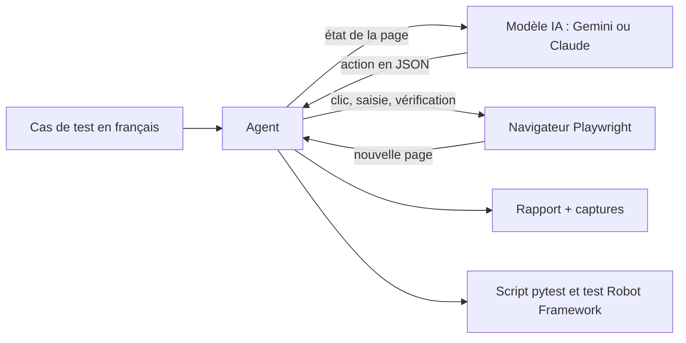

# Agent QA Playwright


Un agent IA qui exécute un cas de test écrit en français, comme le ferait un testeur, puis génère le test automatisé correspondant.

On lui donne un cas de test (étapes et résultats attendus, comme dans Squash TM). L'agent pilote un vrai navigateur avec Playwright, vérifie chaque résultat attendu et produit :

- un **rapport** avec le statut (PASS, FAIL ou BLOQUÉ), le détail de chaque action, la raison donnée par l'IA et une capture d'écran par étape ;
- un **script pytest-playwright** qui rejoue le test sans IA, prêt pour une campagne de non-régression ;
- un **test Robot Framework** (SeleniumLibrary) qui rejoue le même parcours avec Selenium, pour les équipes qui automatisent avec Robot Framework.

L'IA sert donc une seule fois, pour automatiser le cas de test. Les exécutions suivantes, avec pytest ou Robot Framework, sont gratuites, rapides et déterministes.

L'agent se pilote en ligne de commande ou avec **Alfred**, une interface vocale qui commente la mission en direct (voir [Alfred, l'interface vocale](#alfred-linterface-vocale)).


## Comment ça marche



À chaque tour :

1. **Observer** : l'agent liste les éléments visibles de la page (champs, boutons, liens) et les numérote.
2. **Décider** : il envoie au modèle le cas de test, l'historique et cette liste. Le modèle répond par une seule action en JSON, par exemple `{"action": "fill", "args": {"ref": 1, "text": "standard_user"}}`.
3. **Agir** : l'agent valide la réponse, exécute l'action avec Playwright et prend une capture.
4. On recommence jusqu'à ce que le modèle termine le test.

## Les garde-fous

Une IA peut se tromper. Le programme ne lui fait pas confiance aveuglément :

- **Pas de sélecteur inventé** : le modèle désigne un élément par son numéro dans la liste, il ne peut pas cibler un élément qui n'existe pas.
- **Réponse validée** : une réponse mal formée ou une action inconnue n'est jamais exécutée. L'erreur est renvoyée au modèle pour qu'il corrige.
- **Statut fondé sur les vérifications** : si une vérification échoue, le test est FAIL, même si le modèle conclut PASS. Un PASS sans aucune vérification est refusé (statut BLOQUÉ).
- **Limites** : 20 actions maximum et arrêt après 3 erreurs de suite.
- **Clés protégées** : les clés d'API restent dans un fichier `.env`, exclu de Git.

## Installation (Mac ou Linux)

Il faut Python 3.10 ou plus récent.

```bash
git clone https://github.com/smail-ops/agent-qa-playwright.git
cd agent-qa-playwright
python3 -m venv .venv
source .venv/bin/activate
pip install -r requirements.txt
playwright install chromium
cp .env.example .env
```

Ouvre ensuite le fichier `.env` et colle ta clé Gemini après `GEMINI_API_KEY=`. Elle se crée gratuitement sur [Google AI Studio](https://aistudio.google.com).

## Premier essai, sans clé d'API

Le dossier `demo_site/` contient une petite boutique de démonstration. Le fournisseur `scripted` rejoue un scénario écrit à l'avance, sans IA. Pratique pour vérifier l'installation.

Dans un premier terminal :

```bash
python3 -m http.server 8000 -d demo_site
```

Dans un second terminal (environnement `.venv` activé) :

```bash
python -m agent cas_de_test/demo/CT-00_demo_locale.md --provider scripted --scenario cas_de_test/demo/scenario_CT-00.json --headed
```

Un exemple du rapport obtenu est visible dans [`docs/exemple-demo`](docs/exemple-demo/rapport.md).

Encore plus simple : `python -m alfred` ouvre l'interface Alfred, qui sert elle-même le site de démo (un seul terminal suffit).

## Lancer un vrai test avec l'IA

Les cas de test du dossier `cas_de_test/` portent sur [SauceDemo](https://www.saucedemo.com), un site public conçu pour s'entraîner au test.

```bash
python -m agent cas_de_test/CT-01_connexion_valide.md --headed --pause 4
```

- `--headed` affiche le navigateur pendant le test.
- `--pause 4` attend 4 secondes entre deux actions, pour rester dans les quotas de l'offre gratuite de Gemini.
- `--provider claude` utilise Claude à la place de Gemini (clé `ANTHROPIC_API_KEY` dans `.env`).
- `--model` choisit un modèle précis, par exemple `--model gemini-3.8-flash`. Par défaut, l'agent utilise l'alias `gemini-flash-latest`, qui suit le dernier modèle Flash de Google.

Le programme renvoie un code de sortie exploitable en intégration continue : 0 pour PASS, 1 pour FAIL, 2 pour BLOQUÉ, 3 pour une erreur de configuration.

## Alfred, l'interface vocale

Alfred est une interface web locale. On choisit un cas de test (ou on l'écrit), Alfred lance l'agent et annonce chaque action à voix haute, pendant que le cadran montre où en est la mission et que la vue du navigateur s'affiche en direct. À la fin : le verdict, le rapport et les deux tests générés.

```bash
python -m alfred
```

La page s'ouvre toute seule sur http://127.0.0.1:8765. Alfred sert aussi le site de démo : le cas CT-00 fonctionne avec le moteur « Démo sans IA », sans clé d'API.

- **Le cadran** : l'anneau extérieur compte les actions (20 au plus), en vert les vérifications réussies et en rouge les échecs. L'anneau intérieur montre la phase en cours : observer, réfléchir, agir.
- **La voix** : Alfred annonce ce qu'il fait, puis le verdict. Les mots de passe ne sont jamais lus ni affichés.
- **Les commandes vocales** : bouton micro, puis « lance la démo », « lance le cas 2 », « arrête » ou « ouvre le rapport ».
- **Écrire un cas de test** directement dans la page, le lancer, puis l'enregistrer dans `cas_de_test/`.
- **Réglages** : votre prénom, pour qu'Alfred vous salue, et le choix de sa voix.

Sous le capot, le serveur n'utilise que la bibliothèque standard de Python et la page n'a pas de framework. Chaque événement de l'agent (observer, réfléchir, agir, étape terminée) est diffusé à la page en Server-Sent Events. Le serveur n'écoute que sur 127.0.0.1, refuse les requêtes venant d'autres sites et ne sert que les fichiers de ses propres missions.

## Écrire un cas de test

Un fichier Markdown, avec un titre et une URL. Le reste est lu par l'IA comme par un testeur :

```markdown
# CT-02 Connexion refusée pour un utilisateur bloqué
URL : https://www.saucedemo.com/

## Étapes
1. Saisir « locked_out_user » dans le champ Username
2. Saisir « secret_sauce » dans le champ Password
3. Cliquer sur le bouton Login

## Résultats attendus
- Le message « Sorry, this user has been locked out. » s'affiche
- L'URL ne contient pas « inventory »
```

Les résultats attendus négatifs (« ne s'affiche pas », « ne contient pas ») sont pris en charge : l'agent les contrôle avec une vérification « absent », traduite dans le script pytest par `not_to_contain_text` ou `not_to_have_url`, et dans le test Robot par `La page n'affiche pas` ou `Wait Until Location Does Not Contain`.

## Résultats

Chaque exécution crée un dossier `rapports/<date>_<cas_de_test>/` contenant :

| Fichier | Contenu |
|---|---|
| `rapport.md` | statut, tableau des étapes avec la raison de chaque action, vérifications |
| `captures/` | une capture d'écran par étape |
| `test_<cas_de_test>.py` | le script pytest qui rejoue le test sans IA |
| `<cas_de_test>.robot` | le test Robot Framework qui rejoue le test avec Selenium |

Pour rejouer le script pytest :

```bash
pytest rapports/<dossier>/test_<cas_de_test>.py
```

### Rejouer avec Robot Framework

Le fichier `.robot` utilise SeleniumLibrary, la bibliothèque de Robot Framework qui pilote le navigateur avec Selenium. Il faut Google Chrome sur la machine : Selenium télécharge seul le pilote qui correspond à sa version.

```bash
robot rapports/<dossier>/<cas_de_test>.robot
```

- `--variable BROWSER:headlesschrome` lance Chrome sans fenêtre, par exemple en intégration continue (`firefox` fonctionne aussi).
- `--variable DELAI:10s` allonge l'attente maximale, 5 secondes par défaut.
- `--outputdir resultats-robot` range le journal (`log.html` et `report.html`) dans un dossier à part.

Le générateur adapte le parcours à Selenium :

- les sélecteurs propres à Playwright (`:has-text`, plusieurs éléments identiques) deviennent des XPath ;
- le texte attendu est écrit tel qu'il apparaît sur la page, et pour une liste déroulante c'est la valeur réelle de l'option qui est utilisée ;
- les vérifications de texte passent par deux mots-clés écrits dans le fichier, `La page affiche` et `La page n'affiche pas`. Comme l'agent, ils ne regardent que le texte visible. `Wait Until Page Contains` compterait aussi un message d'erreur caché dans la page, et le test passerait à tort.

Exemple : [`docs/exemple-demo/ct_00_demo_locale_connexion_et_panier.robot`](docs/exemple-demo/ct_00_demo_locale_connexion_et_panier.robot).

## Tests du projet

Les tests utilisent le site de démo local et le fournisseur `scripted` : ils ne demandent ni clé d'API ni connexion Internet.

```bash
pytest
```

Ils couvrent la lecture des cas de test et des réponses du modèle, la construction des requêtes Gemini et Claude, l'observation de la page, les vérifications positives et négatives, les règles de statut (FAIL forcé, PASS sans vérification refusé, arrêt après erreurs) et les deux tests générés. Le script pytest est rejoué tel quel. Le test `.robot` est exécuté par Robot Framework, avec un double de SeleniumLibrary piloté par Playwright (`tests/robot_double`) pour se passer de Chrome.

Les tests d'Alfred vérifient l'API, le flux en direct, l'arrêt d'une mission, les protections du serveur et la compréhension des commandes vocales, puis pilotent une mission complète dans l'interface.

GitHub Actions lance ces tests à chaque push, puis rejoue le test Robot de la démo avec le vrai SeleniumLibrary et Chrome.

## Structure du code

| Fichier | Rôle |
|---|---|
| `agent/__main__.py` | ligne de commande |
| `agent/testcase.py` | lecture du cas de test en Markdown |
| `agent/browser.py` | observation de la page et exécution des actions Playwright |
| `agent/actions.py` | liste des actions possibles et validation de la réponse JSON du modèle |
| `agent/prompts.py` | consignes données au modèle et message envoyé à chaque tour |
| `agent/providers.py` | appels aux API Gemini et Claude, faux modèle pour les tests |
| `agent/runner.py` | boucle de l'agent, calcul du statut final, événements pour une interface |
| `agent/execution.py` | exécution complète d'un cas de test, commune à la ligne de commande et à Alfred |
| `agent/report.py` | rapport Markdown |
| `agent/codegen.py` | génération du script pytest-playwright |
| `agent/codegen_robot.py` | génération du test Robot Framework (SeleniumLibrary) |
| `tests/robot_double/` | double de SeleniumLibrary piloté par Playwright, pour tester le fichier `.robot` sans Chrome |
| `alfred/server.py` | serveur local d'Alfred : API, flux d'événements en direct, protections |
| `alfred/missions.py` | missions lancées depuis l'interface, une à la fois |
| `alfred/narration.py` | phrases affichées et prononcées par Alfred |
| `alfred/static/index.html` | l'interface : cadran, voix, commandes vocales, journal de mission |

## Dépannage

| Message | Solution |
|---|---|
| `Clé GEMINI_API_KEY absente` | le fichier `.env` manque ou la clé n'est pas collée après `GEMINI_API_KEY=` |
| `Erreur API 404` | le modèle a été retiré : indique un modèle disponible dans `GEMINI_MODEL`, par exemple `gemini-3.8-flash` (liste sur Google AI Studio) |
| `Erreur API 429` | quota de l'offre gratuite atteint : augmente `--pause` ou réessaie plus tard |
| `CERTIFICATE_VERIFY_FAILED` (Mac) | Python installé depuis python.org n'a pas encore ses certificats : double-clique sur `Install Certificates.command` dans le dossier `Applications/Python 3.x` |
| `Executable doesn't exist` | lance `playwright install chromium` |
| `robot: command not found` | active l'environnement (`source .venv/bin/activate`), puis `pip install -r requirements.txt` |
| `SessionNotCreatedException` avec `robot` | Chrome n'est pas installé ou n'a pas pu démarrer : installe Google Chrome, ou essaie `--variable BROWSER:firefox` |
| `Le port 8765 est déjà utilisé` | Alfred tourne déjà : ouvre http://127.0.0.1:8765, ou lance `python -m alfred --port 8766` |
| Alfred ne parle pas | clique d'abord dans la page (le navigateur bloque le son avant toute action), vérifie que « Voix activée » est allumé, et installe une voix française dans Réglages Système, Accessibilité, Contenu énoncé |
| Pas de bouton micro | la reconnaissance vocale dépend du navigateur : elle fonctionne dans Chrome, Safari peut demander d'activer la dictée de macOS, Firefox ne la propose pas |

## Limites et pistes

- Les pages très dynamiques, les iframes et le shadow DOM ne sont pas encore gérés.
- Chaque action coûte un appel au modèle : un cas de test de 10 étapes représente une douzaine d'appels.
- Pistes : import des cas de test depuis un export Squash TM, exécution d'une campagne complète avec un rapport de synthèse, rejeu du test Robot depuis Alfred.

## Licence

MIT
